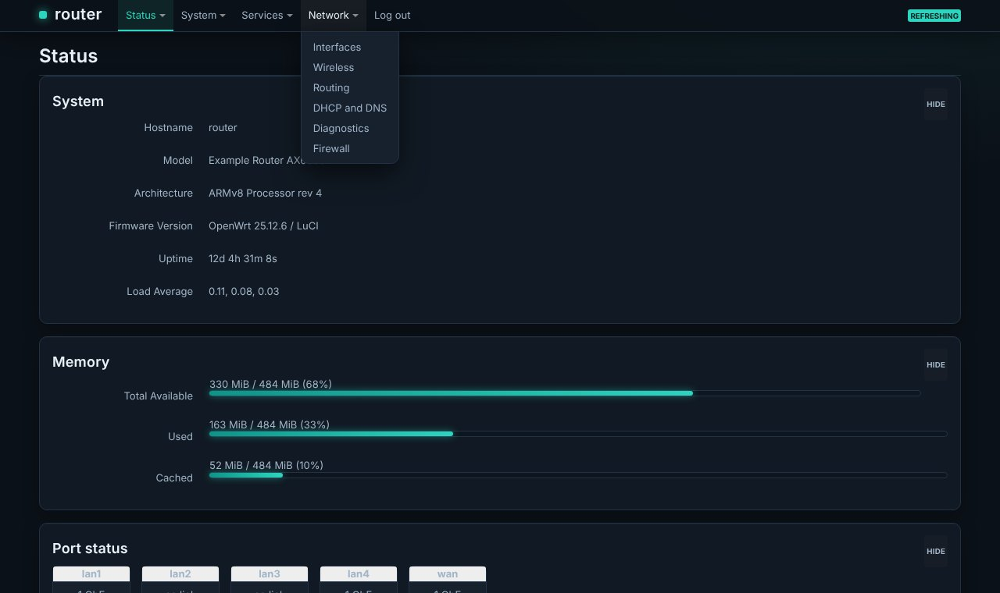
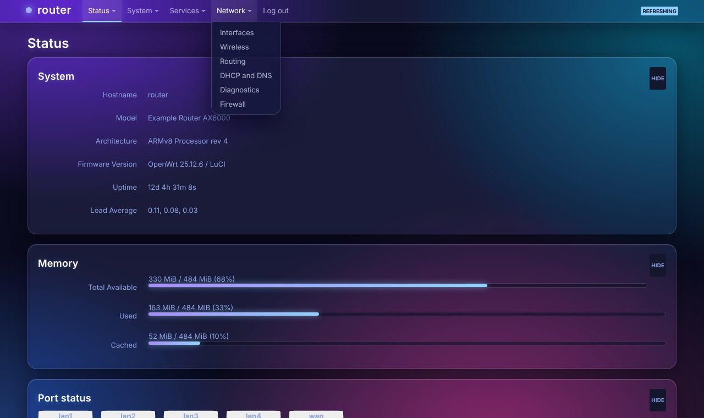
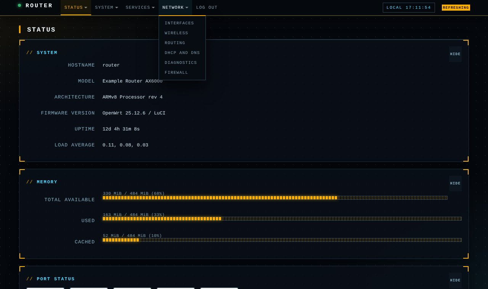
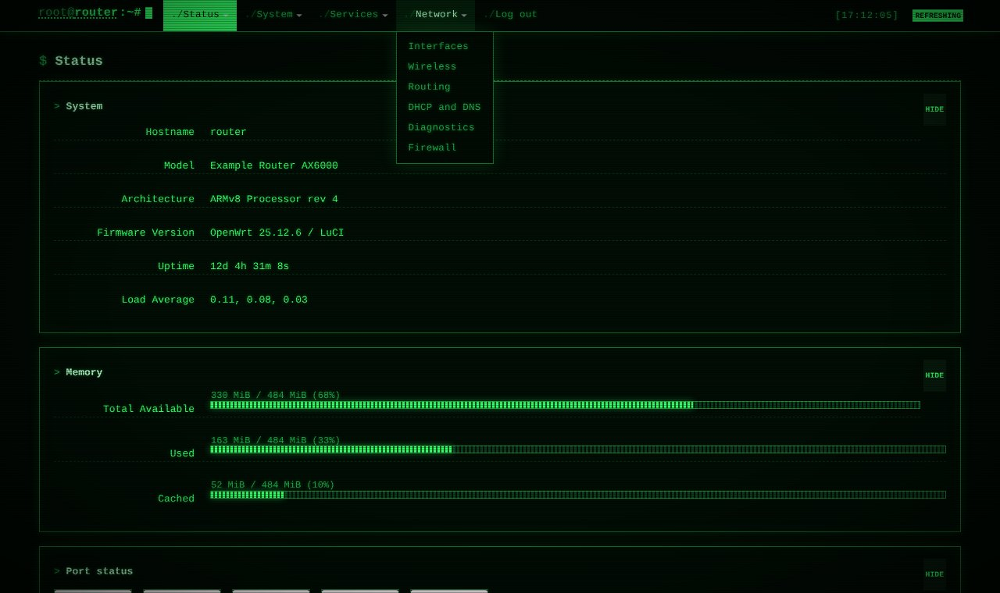
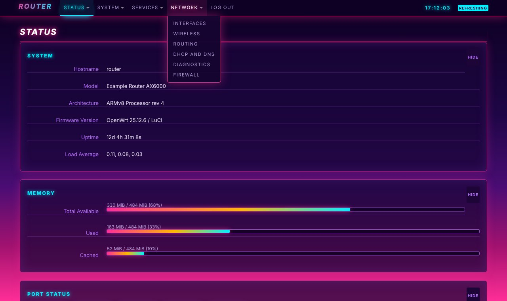
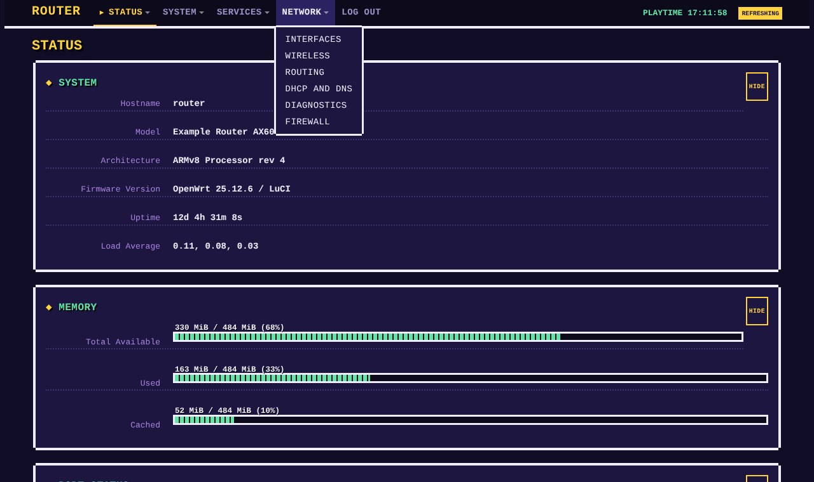
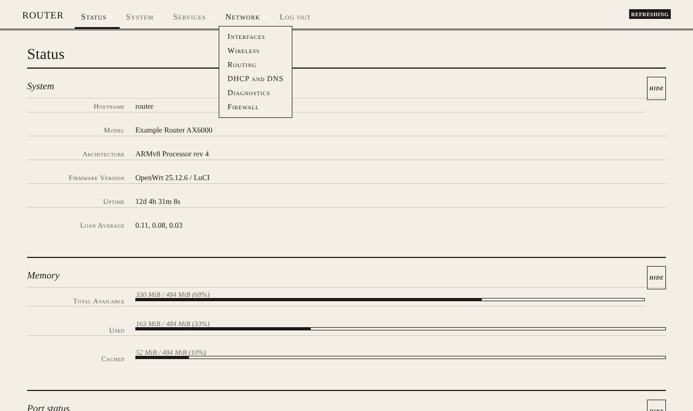
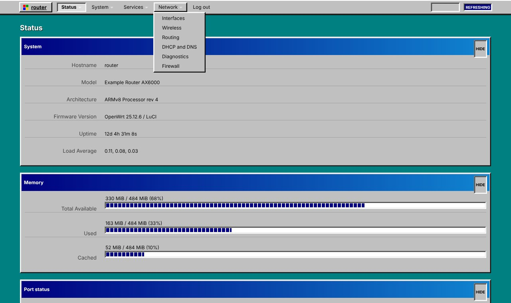
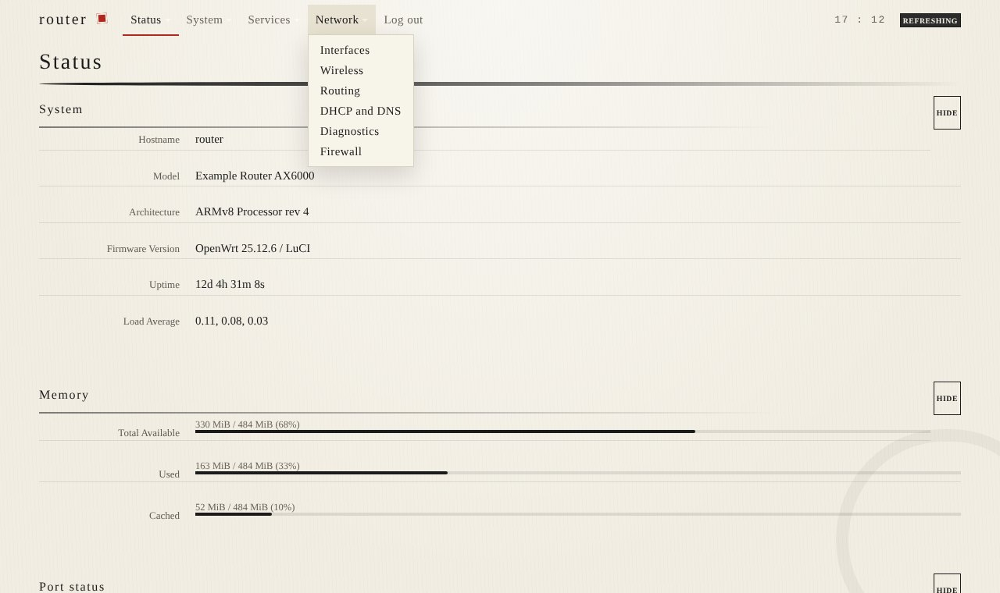
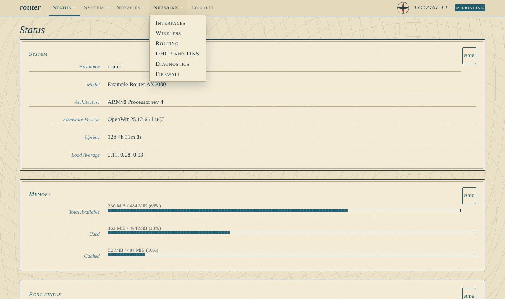

<div align="center">

# openwrt-luci-themes

**Custom themes for the OpenWrt LuCI web interface, with new ones every Friday.**
Install any of them on a router with one line.


</div>

> Every screenshot below is rendered from a mock page filled with made-up data, so nothing here comes from a real router.

## Quick start

On the router (SSH in as root):

```sh
wget -qO- https://raw.githubusercontent.com/vistrocity/openwrt-luci-themes/main/install.sh | sh -s aquarium
```

Swap `aquarium` for any theme name: `obsidian`, `glass`, `mission`, `blueprint`, `terminal`, `synthwave`, `rack`, `teletext`, `pixel`, `aquarium`, `circadian`, `brutal`, `paper`, `retro`, `sumie`, `topo`. Then hard-refresh the browser (Ctrl+Shift+R). The theme also shows up under **System > System > Language and Style**.

## Gallery

<table>
<tr><td width="50%" valign="top">
<a href="luci-theme-obsidian"></a><br>
<b>Obsidian</b> &middot; <sub>Dark</sub><br>
<sub>Slate and teal, rounded cards. The calm all-rounder.</sub><br>
<sub><code>sh -s obsidian</code></sub>
</td><td width="50%" valign="top">
<a href="luci-theme-glass"></a><br>
<b>Glass</b> &middot; <sub>Dark</sub><br>
<sub>Glassmorphism: frosted cards over a violet and cyan gradient.</sub><br>
<sub><code>sh -s glass</code></sub>
</td></tr>
<tr><td width="50%" valign="top">
<a href="luci-theme-mission"></a><br>
<b>Mission Control</b> &middot; <sub>Dark</sub><br>
<sub>Sci-fi HUD in amber and cyan with corner brackets, segmented meters and a live clock.</sub><br>
<sub><code>sh -s mission</code></sub>
</td><td width="50%" valign="top">
<a href="luci-theme-blueprint"></a><br>
<b>Blueprint</b> &middot; <sub>Dark</sub><br>
<sub>White linework on blueprint blue: drafting grid, hatched meters, FIG. numbering.</sub><br>
<sub><code>sh -s blueprint</code></sub>
</td></tr>
<tr><td width="50%" valign="top">
<a href="luci-theme-terminal"></a><br>
<b>Terminal</b> &middot; <sub>Dark</sub><br>
<sub>Green-phosphor CRT with scanlines, a root@host prompt and [ bracketed ] buttons.</sub><br>
<sub><code>sh -s terminal</code></sub>
</td><td width="50%" valign="top">
<a href="luci-theme-synthwave"></a><br>
<b>Synthwave</b> &middot; <sub>Dark</sub><br>
<sub>Neon outrun: striped sun, perspective grid floor, glowing panels.</sub><br>
<sub><code>sh -s synthwave</code></sub>
</td></tr>
<tr><td width="50%" valign="top">
<a href="luci-theme-rack"></a><br>
<b>Rack</b> &middot; <sub>Dark</sub><br>
<sub>Server-rack faceplates with mounting ears, 1U/2U labels and status LEDs.</sub><br>
<sub><code>sh -s rack</code></sub>
</td><td width="50%" valign="top">
<a href="luci-theme-teletext"></a><br>
<b>Teletext</b> &middot; <sub>Dark</sub><br>
<sub>80s TV text: pure black, the eight TV colours, block-graphic bars.</sub><br>
<sub><code>sh -s teletext</code></sub>
</td></tr>
<tr><td width="50%" valign="top">
<a href="luci-theme-pixel"></a><br>
<b>8-bit</b> &middot; <sub>Dark</sub><br>
<sub>Pixel-RPG game menus with notched borders and health-bar meters.</sub><br>
<sub><code>sh -s pixel</code></sub>
</td><td width="50%" valign="top">
<a href="luci-theme-aquarium"></a><br>
<b>Aquarium</b> &middot; <sub>Dark</sub><br>
<sub>Deep-sea gradient, glass panels and slowly rising bubbles.</sub><br>
<sub><code>sh -s aquarium</code></sub>
</td></tr>
<tr><td width="50%" valign="top">
<a href="luci-theme-circadian"></a><br>
<b>Circadian</b> &middot; <sub>Auto</sub><br>
<sub>Changes palette with the local time: dawn, day, dusk, night.</sub><br>
<sub><code>sh -s circadian</code></sub>
</td><td width="50%" valign="top">
<a href="luci-theme-brutal"></a><br>
<b>Neobrutalism</b> &middot; <sub>Light</sub><br>
<sub>Cream paper, thick black outlines, hard shadows, buttons that press down.</sub><br>
<sub><code>sh -s brutal</code></sub>
</td></tr>
<tr><td width="50%" valign="top">
<a href="luci-theme-paper"></a><br>
<b>Paper</b> &middot; <sub>Light</sub><br>
<sub>E-ink / printed page: book serif, hairline rules, one red accent.</sub><br>
<sub><code>sh -s paper</code></sub>
</td><td width="50%" valign="top">
<a href="luci-theme-retro"></a><br>
<b>Retro</b> &middot; <sub>Light</sub><br>
<sub>90s desktop: bevelled windows, navy title bars, blue-block meters.</sub><br>
<sub><code>sh -s retro</code></sub>
</td></tr>
<tr><td width="50%" valign="top">
<a href="luci-theme-sumie"></a><br>
<b>Sumi-e</b> &middot; <sub>Light</sub><br>
<sub>Washi paper, brush-stroke rules, a red seal, lots of whitespace.</sub><br>
<sub><code>sh -s sumie</code></sub>
</td><td width="50%" valign="top">
<a href="luci-theme-topo"></a><br>
<b>Topo</b> &middot; <sub>Light</sub><br>
<sub>Sepia sea-chart with contour rings and a compass rose.</sub><br>
<sub><code>sh -s topo</code></sub>
</td></tr>
</table>

### Circadian through the day

<table><tr><td width="25%"><br><sub>dawn</sub></td><td width="25%"><br><sub>day</sub></td><td width="25%"><br><sub>dusk</sub></td><td width="25%"><br><sub>night</sub></td></tr></table>

### Forms, tabs and buttons

<table><tr><td width="25%"><br><sub>Obsidian</sub></td><td width="25%"><br><sub>Neobrutalism</sub></td><td width="25%"><br><sub>Aquarium</sub></td><td width="25%"><br><sub>Retro</sub></td></tr></table>

## Going back

Pick the stock theme again under **System > System > Language and Style**, or from SSH:

```sh
uci set luci.main.mediaurlbase=/luci-static/bootstrap && uci commit luci
```

## Install without internet on the router

Each theme folder is a complete, self-contained package source and has its own `install.sh`:

```sh
scp -O -r luci-theme-rack root@192.168.1.1:/tmp/
ssh root@192.168.1.1 sh /tmp/luci-theme-rack/install.sh
```

To update only the stylesheet of an installed theme:

```sh
scp -O luci-theme-rack/htdocs/luci-static/rack/cascade.css root@192.168.1.1:/www/luci-static/rack/cascade.css
```

## Build as an OpenWrt package

Every theme has a standard `luci.mk` Makefile. Drop the folder into your `feeds/luci/themes/` (or a custom feed) and enable `luci-theme-<name>` in `make menuconfig`.

## Customise

Each stylesheet ends with a clearly marked override block after the stock Bootstrap rules. The colours are CSS variables at the top of that block (the newer themes use `--t-accent`, `--t-bg`, `--t-card` and friends), so re-colouring a theme is usually a few edits.

## Regenerate the screenshots

```sh
npm i playwright
node tools/previews/make-previews.js            # all themes
node tools/previews/make-previews.js rack topo  # just these
```

## How they're made

The themes are forks of [`luci-theme-bootstrap`](https://github.com/openwrt/luci/tree/master/themes/luci-theme-bootstrap), with the stock rules kept intact and a theme-specific layer added on top. They were developed against OpenWrt 25.12 on a MediaTek Filogic router (ucode templates). Older LuCI releases that still use Lua templates are not supported.

## Licence

Apache-2.0, the same as the LuCI project they derive from. See [`LICENSE`](LICENSE).
