<div align="center">

# openwrt-luci-themes

**Custom themes for the OpenWrt LuCI web interface, with new ones every Friday.**
Install any of them on a router with one line.

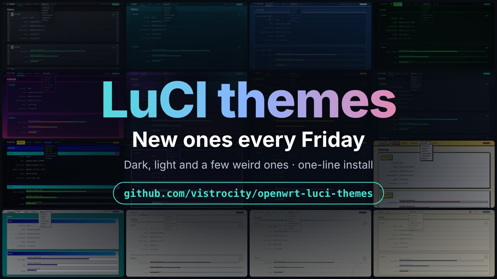


</div>

> Every screenshot below is rendered from a mock page filled with made-up data, so nothing here comes from a real router.

## Quick start

On the router (SSH in as root):

```sh
wget -qO- https://raw.githubusercontent.com/vistrocity/openwrt-luci-themes/main/install.sh | sh -s aquarium
```

Swap `aquarium` for any theme name: <!-- NAMES:START -->`rack`, `blueprint`, `teletext`, `aquarium`, `obsidian`, `glass`, `mission`, `terminal`, `synthwave`, `pixel`, `circadian`, `brutal`, `paper`, `retro`, `sumie`, `topo`<!-- NAMES:END -->. Then hard-refresh the browser (Ctrl+Shift+R). The theme also shows up under **System > System > Language and Style**.

## Latest drop

<!-- GALLERY:START -->
<table>
<tr>
<td width="25%" valign="top" align="center">
<a href="themes/luci-theme-rack">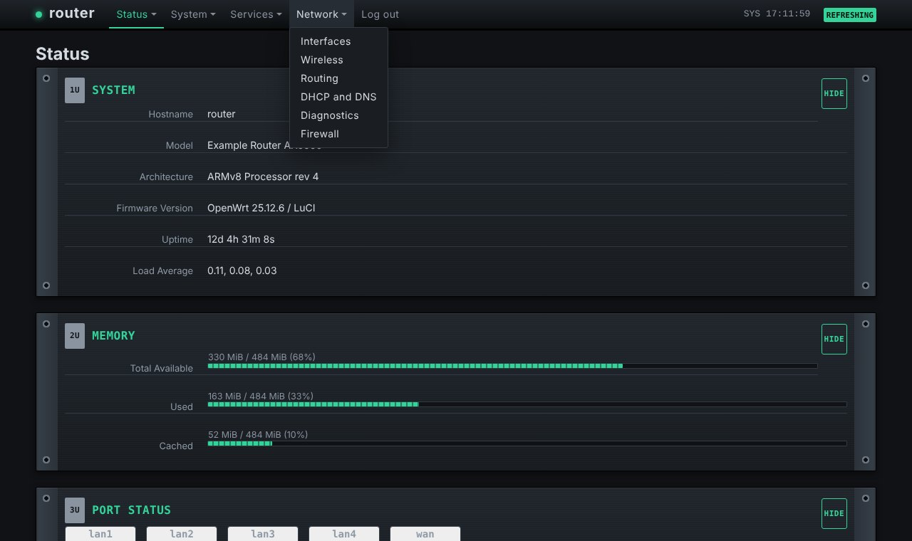</a><br>
<b>Rack</b><br><sub>Dark</sub><br><sub><code>sh -s rack</code></sub>
</td>
<td width="25%" valign="top" align="center">
<a href="themes/luci-theme-blueprint">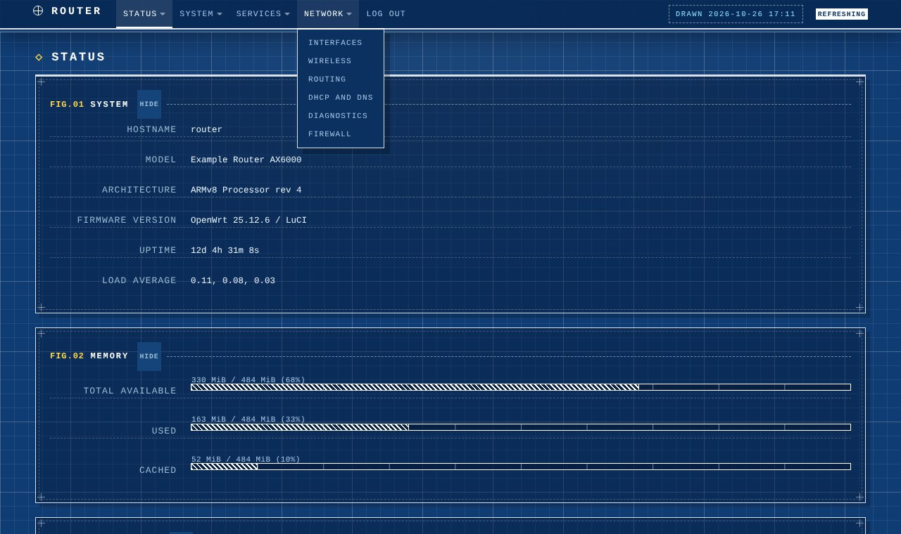</a><br>
<b>Blueprint</b><br><sub>Dark</sub><br><sub><code>sh -s blueprint</code></sub>
</td>
<td width="25%" valign="top" align="center">
<a href="themes/luci-theme-teletext">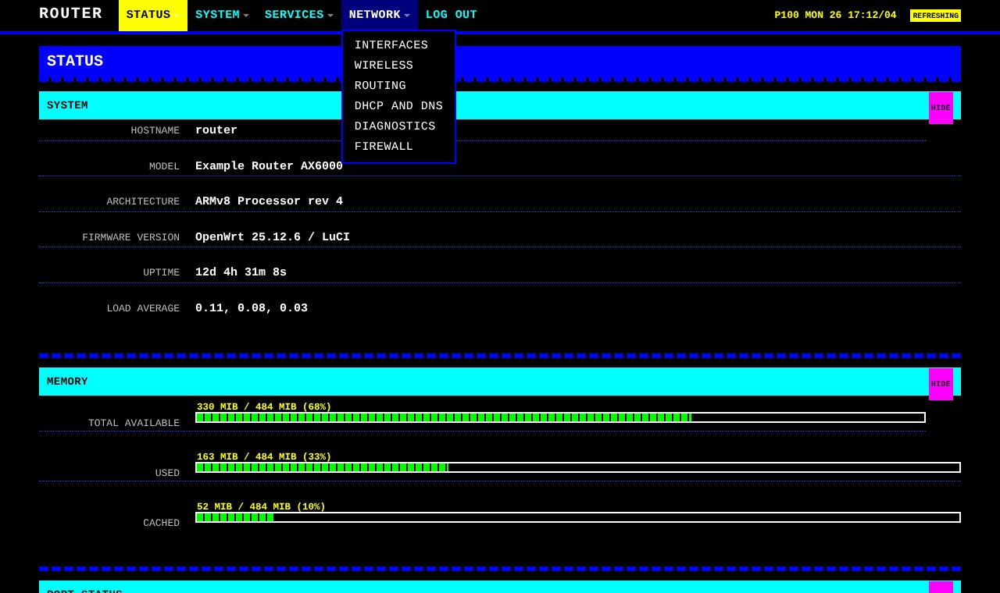</a><br>
<b>Teletext</b><br><sub>Dark</sub><br><sub><code>sh -s teletext</code></sub>
</td>
<td width="25%" valign="top" align="center">
<a href="themes/luci-theme-aquarium">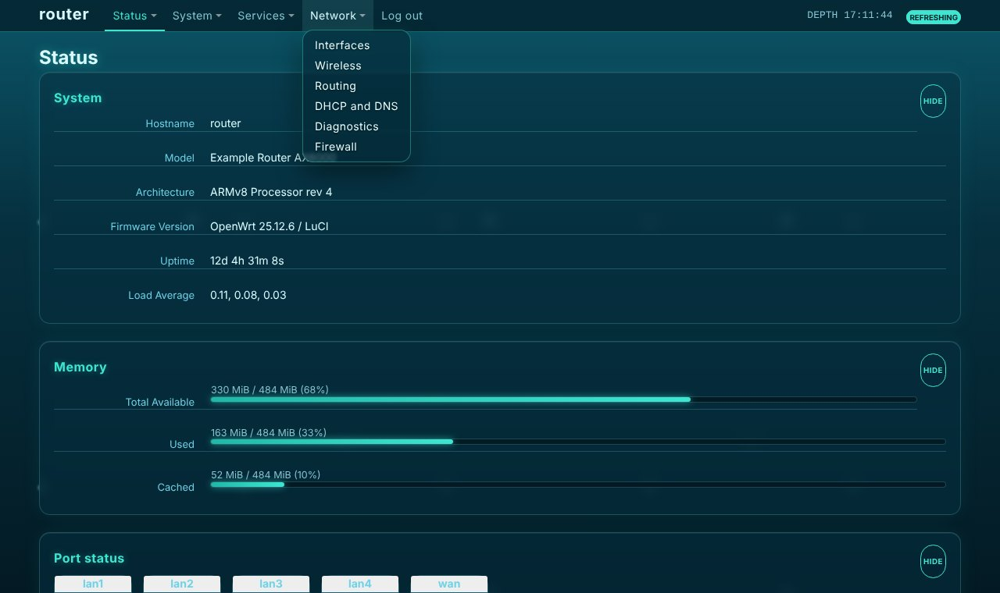</a><br>
<b>Aquarium</b><br><sub>Dark</sub><br><sub><code>sh -s aquarium</code></sub>
</td>
</tr>
</table>
<sub>Released 2026-10-30.</sub>
<!-- GALLERY:END -->

A new batch ships every Friday.

## All themes

<!-- LIST:START -->
| Theme | Mode | Look | Install name | Preview |
|---|---|---|---|---|
| [Rack](themes/luci-theme-rack) | Dark | Server-rack faceplates with mounting ears, 1U/2U labels and status LEDs. | `rack` | [overview](docs/screenshots/rack-overview.jpg) &middot; [settings](docs/screenshots/rack-settings.jpg) |
| [Blueprint](themes/luci-theme-blueprint) | Dark | White linework on blueprint blue: drafting grid, hatched meters, FIG. numbering. | `blueprint` | [overview](docs/screenshots/blueprint-overview.jpg) &middot; [settings](docs/screenshots/blueprint-settings.jpg) |
| [Teletext](themes/luci-theme-teletext) | Dark | 80s TV text: pure black, the eight TV colours, block-graphic bars. | `teletext` | [overview](docs/screenshots/teletext-overview.jpg) &middot; [settings](docs/screenshots/teletext-settings.jpg) |
| [Aquarium](themes/luci-theme-aquarium) | Dark | Deep-sea gradient, glass panels and slowly rising bubbles. | `aquarium` | [overview](docs/screenshots/aquarium-overview.jpg) &middot; [settings](docs/screenshots/aquarium-settings.jpg) |
| [Obsidian](themes/luci-theme-obsidian) | Dark | Slate and teal, rounded cards. The calm all-rounder. | `obsidian` | [overview](docs/screenshots/obsidian-overview.jpg) &middot; [settings](docs/screenshots/obsidian-settings.jpg) |
| [Glass](themes/luci-theme-glass) | Dark | Glassmorphism: frosted cards over a violet and cyan gradient. | `glass` | [overview](docs/screenshots/glass-overview.jpg) &middot; [settings](docs/screenshots/glass-settings.jpg) |
| [Mission Control](themes/luci-theme-mission) | Dark | Sci-fi HUD in amber and cyan with corner brackets, segmented meters and a live clock. | `mission` | [overview](docs/screenshots/mission-overview.jpg) &middot; [settings](docs/screenshots/mission-settings.jpg) |
| [Terminal](themes/luci-theme-terminal) | Dark | Green-phosphor CRT with scanlines, a root@host prompt and [ bracketed ] buttons. | `terminal` | [overview](docs/screenshots/terminal-overview.jpg) &middot; [settings](docs/screenshots/terminal-settings.jpg) |

<details>
<summary><b>Show older themes</b></summary>

| Theme | Mode | Look | Install name | Preview |
|---|---|---|---|---|
| [Synthwave](themes/luci-theme-synthwave) | Dark | Neon outrun: striped sun, perspective grid floor, glowing panels. | `synthwave` | [overview](docs/screenshots/synthwave-overview.jpg) &middot; [settings](docs/screenshots/synthwave-settings.jpg) |
| [8-bit](themes/luci-theme-pixel) | Dark | Pixel-RPG game menus with notched borders and health-bar meters. | `pixel` | [overview](docs/screenshots/pixel-overview.jpg) &middot; [settings](docs/screenshots/pixel-settings.jpg) |
| [Circadian](themes/luci-theme-circadian) | Auto | Changes palette with the local time: dawn, day, dusk, night. | `circadian` | [overview](docs/screenshots/circadian-overview.jpg) &middot; [settings](docs/screenshots/circadian-settings.jpg) |
| [Neobrutalism](themes/luci-theme-brutal) | Light | Cream paper, thick black outlines, hard shadows, buttons that press down. | `brutal` | [overview](docs/screenshots/brutal-overview.jpg) &middot; [settings](docs/screenshots/brutal-settings.jpg) |
| [Paper](themes/luci-theme-paper) | Light | E-ink / printed page: book serif, hairline rules, one red accent. | `paper` | [overview](docs/screenshots/paper-overview.jpg) &middot; [settings](docs/screenshots/paper-settings.jpg) |
| [Retro](themes/luci-theme-retro) | Light | 90s desktop: bevelled windows, navy title bars, blue-block meters. | `retro` | [overview](docs/screenshots/retro-overview.jpg) &middot; [settings](docs/screenshots/retro-settings.jpg) |
| [Sumi-e](themes/luci-theme-sumie) | Light | Washi paper, brush-stroke rules, a red seal, lots of whitespace. | `sumie` | [overview](docs/screenshots/sumie-overview.jpg) &middot; [settings](docs/screenshots/sumie-settings.jpg) |
| [Topo](themes/luci-theme-topo) | Light | Sepia sea-chart with contour rings and a compass rose. | `topo` | [overview](docs/screenshots/topo-overview.jpg) &middot; [settings](docs/screenshots/topo-settings.jpg) |

</details>
<!-- LIST:END -->

### Circadian through the day

<table><tr><td width="25%">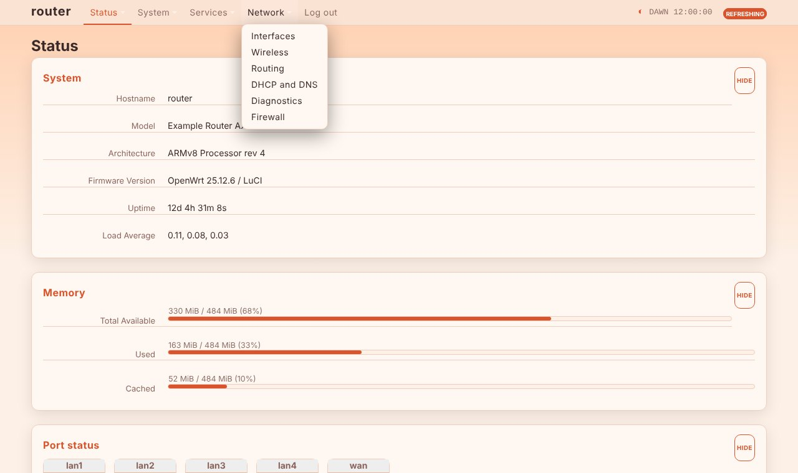<br><sub>dawn</sub></td><td width="25%">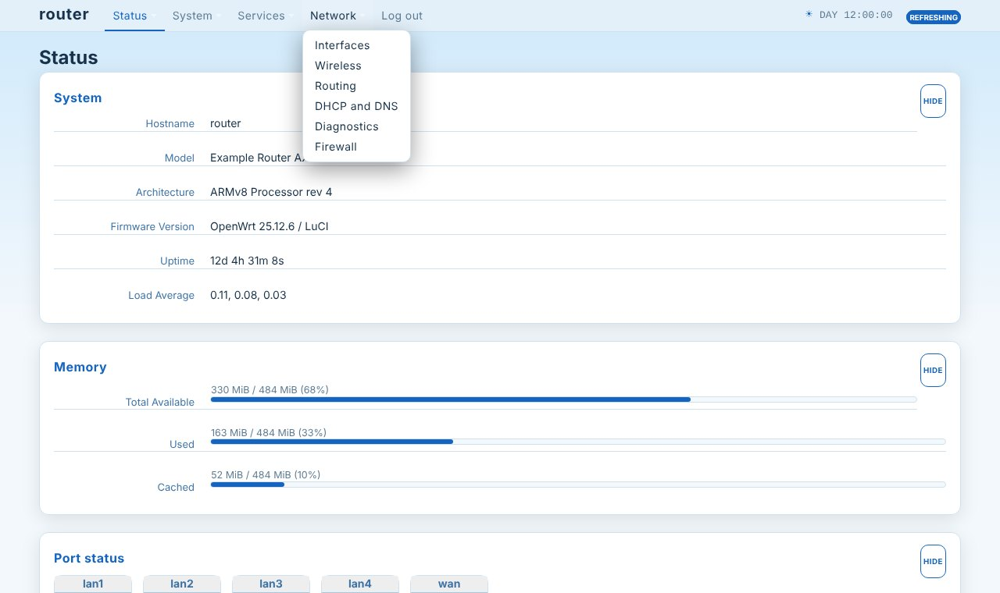<br><sub>day</sub></td><td width="25%">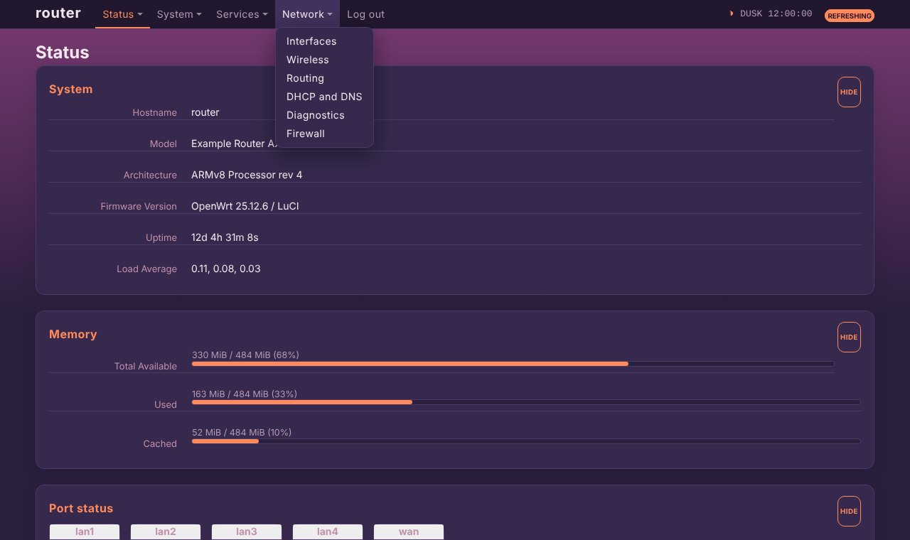<br><sub>dusk</sub></td><td width="25%">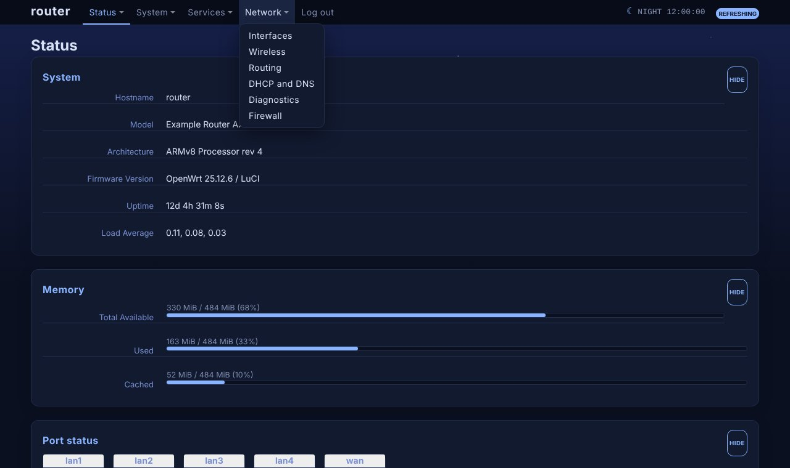<br><sub>night</sub></td></tr></table>

### Forms, tabs and buttons

<table><tr><td width="25%">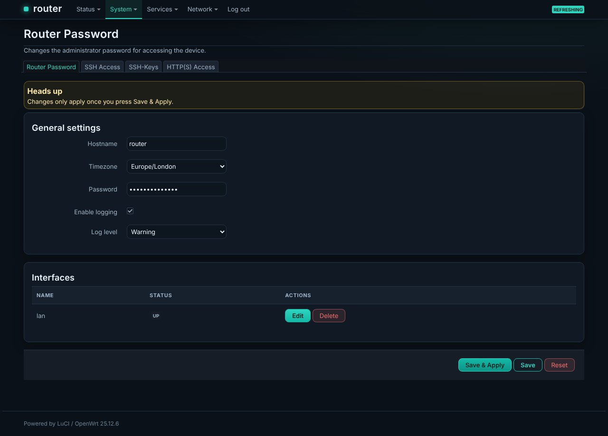<br><sub>Obsidian</sub></td><td width="25%"><br><sub>Neobrutalism</sub></td><td width="25%">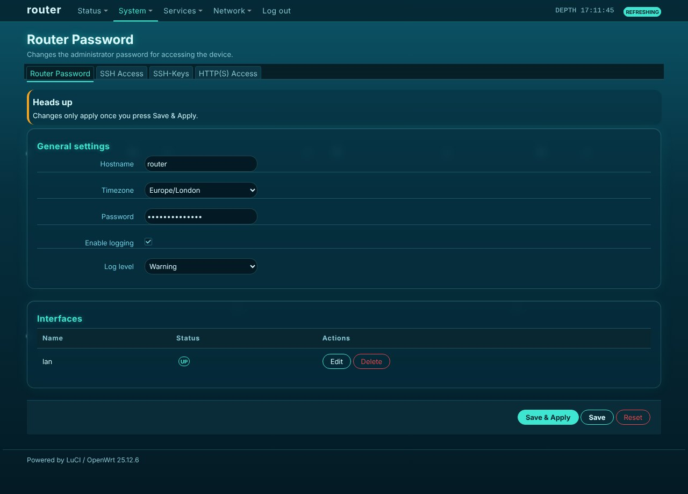<br><sub>Aquarium</sub></td><td width="25%">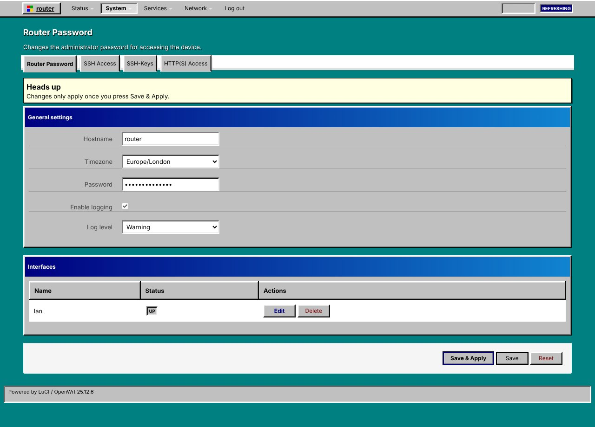<br><sub>Retro</sub></td></tr></table>

## Going back

Pick the stock theme again under **System > System > Language and Style**, or from SSH:

```sh
uci set luci.main.mediaurlbase=/luci-static/bootstrap && uci commit luci
```

## Install without internet on the router

Each theme folder is a complete, self-contained package source and has its own `install.sh`:

```sh
scp -O -r themes/luci-theme-rack root@192.168.1.1:/tmp/
ssh root@192.168.1.1 sh /tmp/luci-theme-rack/install.sh
```

To update only the stylesheet of an installed theme:

```sh
scp -O themes/luci-theme-rack/htdocs/luci-static/rack/cascade.css root@192.168.1.1:/www/luci-static/rack/cascade.css
```

## Build as an OpenWrt package

Every theme has a standard `luci.mk` Makefile. Drop a folder from `themes/` into your `feeds/luci/themes/` (or a custom feed) and enable `luci-theme-<name>` in `make menuconfig`.

## Customise

Each stylesheet ends with a clearly marked override block after the stock Bootstrap rules. The colours are CSS variables at the top of that block (the newer themes use `--t-accent`, `--t-bg`, `--t-card` and friends), so re-colouring a theme is usually a few edits.

## Regenerate the screenshots

```sh
npm i playwright
node tools/previews/make-previews.js            # all themes
node tools/previews/make-previews.js rack topo  # just these
```

## How they're made

The themes are forks of [`luci-theme-bootstrap`](https://github.com/openwrt/luci/tree/master/themes/luci-theme-bootstrap), with the stock rules kept intact and a theme-specific layer added on top. They were developed against OpenWrt 25.12 on a MediaTek Filogic router (ucode templates). Older LuCI releases that still use Lua templates are not supported.

## What the code does

A theme is more than CSS: each one ships a small menu script, a login-page script and three ucode templates (header, footer, login), all adapted from luci-theme-bootstrap. They run in your browser with the rights of the logged-in admin, so they are kept deliberately boring. Every theme is checked by `tools/audit-theme.sh`, which fails on:

- network calls (`fetch`, `XMLHttpRequest`, `WebSocket`, `sendBeacon`), `eval` / `new Function`, `document.write`, cookies and browser storage
- any external URL, `@import`, `<iframe>`, or `<script src>` other than LuCI's own scripts
- downloads, pipes to a shell or package installs in the per-theme shell scripts
- unexpected file types inside a theme folder

The only thing that touches the network is the top-level `install.sh`, which downloads this repository from GitHub; read it before running it. The audit is a pattern scan, not a formal review, and the code is small enough to read yourself.

## Third-party LuCI apps

The themes are forks of luci-theme-bootstrap and keep its class names and CSS variables, so apps built from the standard LuCI pieces (sections, tables, buttons, tabs, dropdowns, progress bars) pick the theme up automatically.

Apps that ship their own CSS with hard-coded colours, or draw custom widgets or canvases, can look out of place, mostly on the dark themes. If one does, open a ["Something looks wrong"](../../issues/new/choose) issue with the theme, the app and a screenshot (blank out anything private). Colours that belong to the app can usually be fixed with a short override in the app's CSS; problems in the theme itself get fixed here.

## Theme requests

New themes ship every Friday. Have a look you'd like on your router? Open a ["Theme request"](../../issues/new/choose) issue.

## Licence

Apache-2.0, the same as the LuCI project they derive from. See [`LICENSE`](LICENSE).
