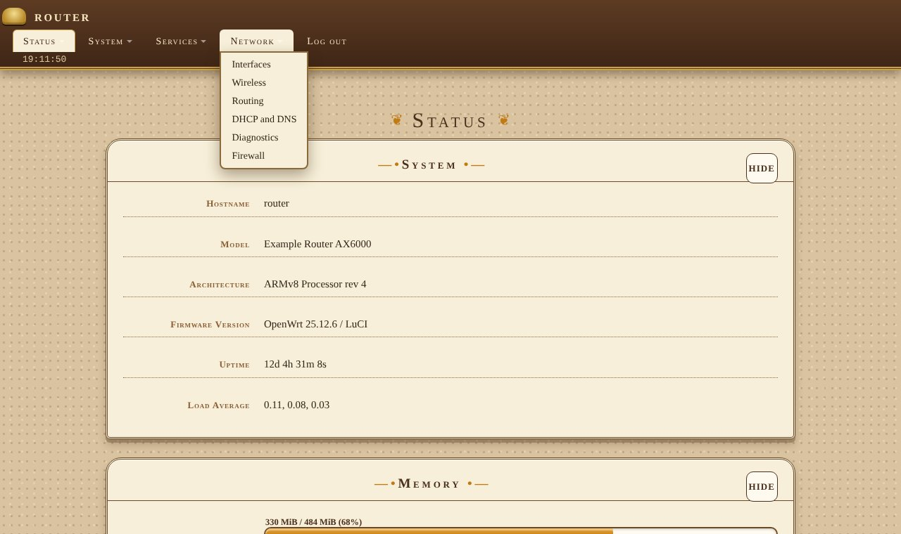
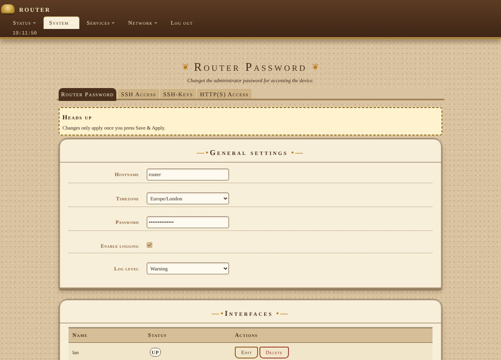

# luci-theme-apothecary

Apothecary: a custom theme for LuCI, forked from luci-theme-bootstrap (Apache-2.0). Light theme.

Pharmacy drawer labels: cream cartridge labels with double rules, small caps, amber glass vial meters on cork

## Install on a router
    wget -qO- https://raw.githubusercontent.com/vistrocity/openwrt-luci-themes/main/install.sh | sh -s apothecary

Then hard-refresh the browser (Ctrl+Shift+R). Revert: System > System > Language and Style, or
`uci set luci.main.mediaurlbase=/luci-static/bootstrap && uci commit luci`.
