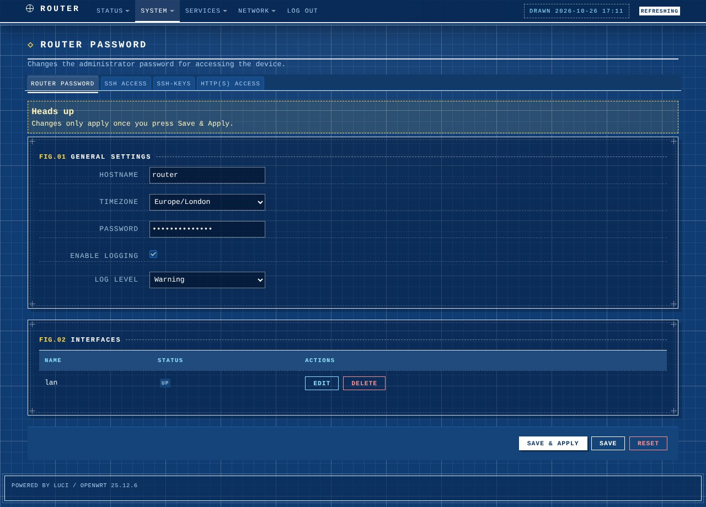

# luci-theme-blueprint

Blueprint: a technical-drawing theme for LuCI, forked from luci-theme-bootstrap (Apache-2.0).

- White linework on blueprint blue, with a 20px / 100px drafting grid behind everything
- Panels have a solid outline, a dashed inner frame and corner registration crosshairs
- Section titles are numbered like figures (`FIG.01`, `FIG.02`, ...) with a dashed dimension line
- Progress bars are dimension-style: tick marks on the track, hatched (45-degree) fill
- Header strip with a compass datum mark and a "DRAWN yyyy-mm-dd hh:mm" stamp
- Footer is styled as a drawing title block
- Save & Apply is the white "stamped" button (yellow on hover); Save/Add are white outlines,
  action/edit are cyan, Delete/Reset are red-pencil outlines
- Dark-only

## Install on a router (fastest)
    wget -qO- https://raw.githubusercontent.com/vistrocity/openwrt-luci-themes/main/install.sh | sh -s blueprint

or copy the folder over (`scp -O -r luci-theme-blueprint root@192.168.1.1:/tmp/`) and run
`sh /tmp/luci-theme-blueprint/install.sh`. Then hard-refresh the browser.

To revert: System > System > Language and Style, or
`uci set luci.main.mediaurlbase=/luci-static/bootstrap && uci commit luci`.

## Customise
Everything is in the "Blueprint overrides" block at the end of
`htdocs/luci-static/blueprint/cascade.css`: `--bp-blue` for the paper colour, `--bp-yellow` /
`--bp-cyan` for the markup accents, `--bp-reg` for the corner marks, and the body background
for grid spacing.
