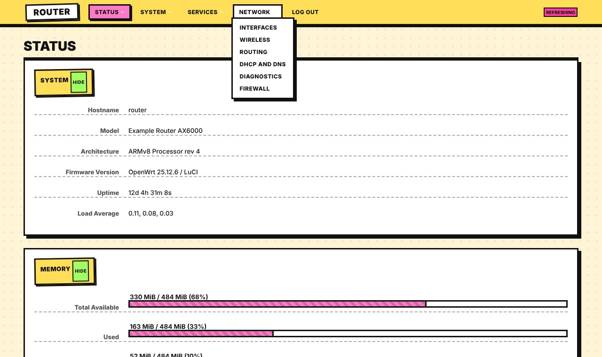
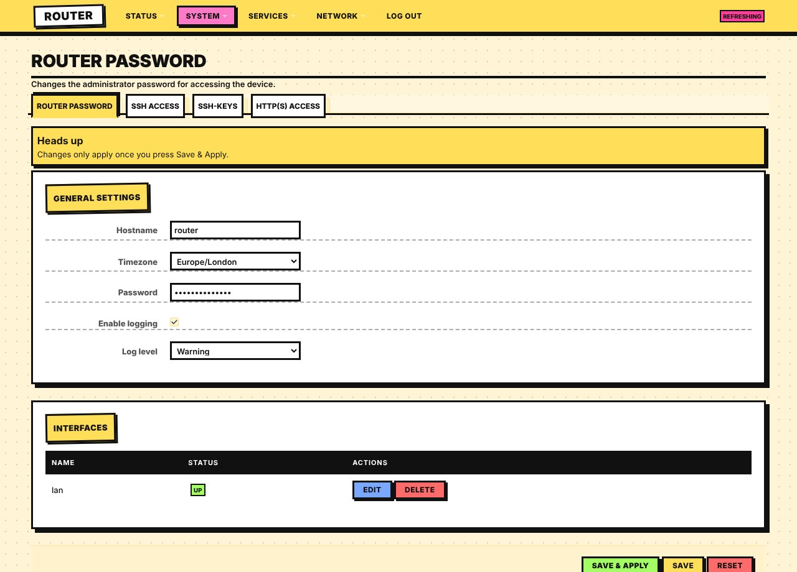

# luci-theme-brutal

Neobrutalism for LuCI, forked from luci-theme-bootstrap (Apache-2.0). Light theme.

- Cream dotted paper, 3px black outlines, hard offset shadows, flat loud colours
- Tilted brand sticker and tilted yellow section labels
- Buttons physically press down on click (offset shadow collapses)
- Save & Apply is lime, Save/Add yellow, Edit/Action blue, Delete/Reset red
- Black table headers, yellow row highlight, striped pink meters with a hard edge
- Animations/tilt switch off under "reduce motion"

## Install on a router
    wget -qO- https://raw.githubusercontent.com/vistrocity/openwrt-luci-themes/main/install.sh | sh -s brutal

Then hard-refresh the browser. Revert: System > System > Language and Style, or
`uci set luci.main.mediaurlbase=/luci-static/bootstrap && uci commit luci`.

## Customise
"Neobrutalism overrides" at the end of `htdocs/luci-static/brutal/cascade.css`: the `--nb-*` palette
variables at the top of that block (`--nb-yellow`, `--nb-pink`, `--nb-lime`, `--nb-blue`, `--nb-shadow`).
