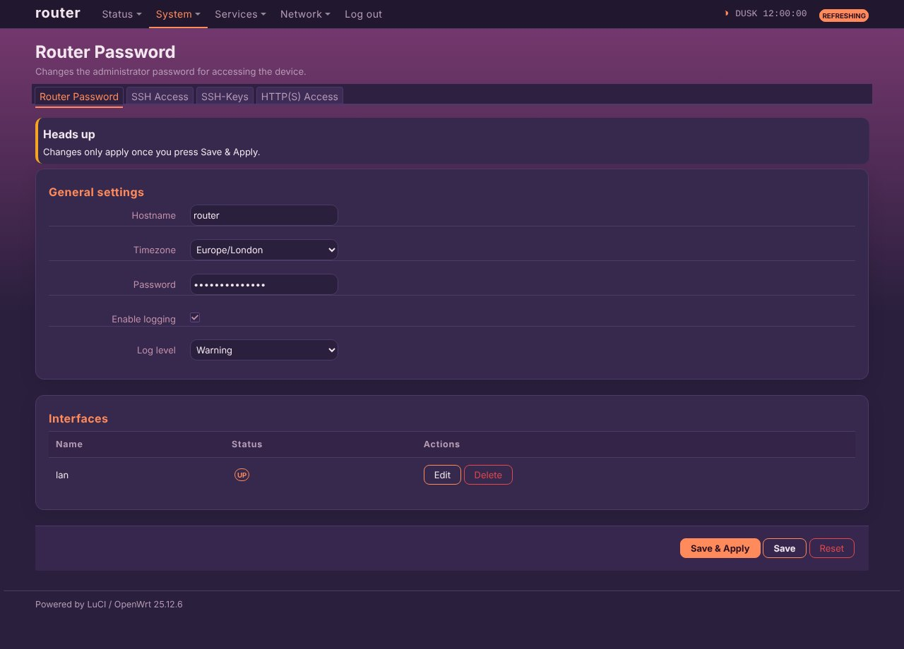

# luci-theme-circadian

Dawn, day and night:   

Circadian: a custom theme for LuCI, forked from luci-theme-bootstrap (Apache-2.0). Dark theme.

- Palette changes with the local time: dawn (5-9), day (9-17), dusk (17-20), night (20-5)
- Light peach at dawn, blue-white by day, violet-orange at dusk, deep navy with stars at night
- A tiny inline script sets `data-tod` on the page; without JavaScript it stays on the night palette

## Install on a router
    wget -qO- https://raw.githubusercontent.com/vistrocity/openwrt-luci-themes/main/install.sh | sh -s circadian

Then hard-refresh the browser (Ctrl+Shift+R). Revert: System > System > Language and Style, or
`uci set luci.main.mediaurlbase=/luci-static/bootstrap && uci commit luci`.

## Customise
"Circadian overrides" at the end of `htdocs/luci-static/circadian/cascade.css`; colours are the `--t-*` variables.
