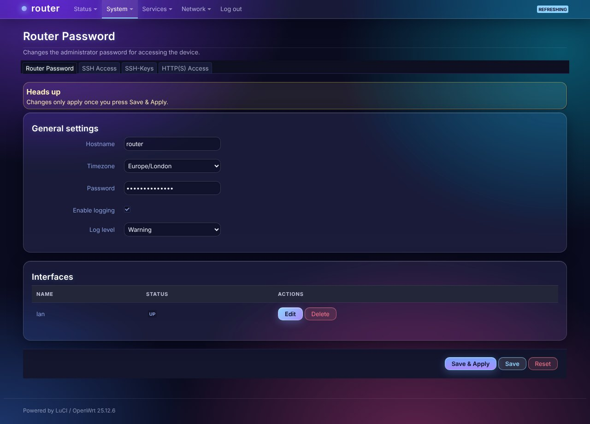

# luci-theme-glass

Glassmorphism LuCI theme, forked from luci-theme-bootstrap (Apache-2.0).
Violet / cyan / pink gradient backdrop, frosted translucent cards (backdrop blur), glass header,
gradient sky-to-violet buttons and progress bars. Dark-only.

Falls back to more opaque surfaces on browsers without `backdrop-filter` or when the OS
asks for reduced transparency.

## Install on a router (fastest)
    scp -O -r luci-theme-glass root@192.168.1.1:/tmp/
    ssh root@192.168.1.1 "sh /tmp/luci-theme-glass/install.sh"

Then hard-refresh the browser. To revert: System > System > Language and Style, or
`uci set luci.main.mediaurlbase=/luci-static/bootstrap && uci commit luci`.

## Customise
Everything lives in the "Glass overrides" block at the end of
`htdocs/luci-static/glass/cascade.css`: gradient blobs on `body`, `--glass-fill` / `--glass-blur`
for frost strength, `--primary-color-*` for the accent.
