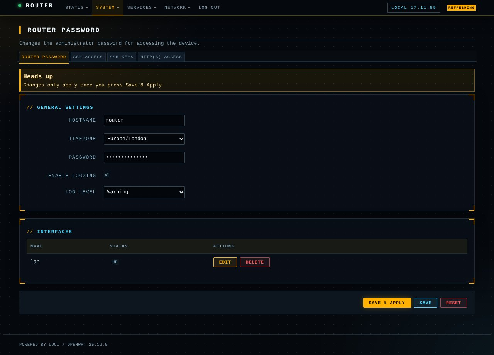

# luci-theme-mission

Mission Control: a sci-fi ops-console HUD theme for LuCI, forked from luci-theme-bootstrap (Apache-2.0).

- Near-black navy with a dot grid, amber primary actions, cyan data accents
- Corner-bracket panels, monospace uppercase labels, `//` section headings
- Segmented amber meters for the progress bars (memory, storage, etc.)
- Header with a blinking status LED and a live local-time clock
- Save & Apply is the only solid amber button; Save/Add are cyan, Delete/Reset red
- Dark-only

## Install on a router (fastest)
    scp -O -r luci-theme-mission root@192.168.1.1:/tmp/
    ssh root@192.168.1.1 "sh /tmp/luci-theme-mission/install.sh"

Then hard-refresh the browser. To revert: System > System > Language and Style, or
`uci set luci.main.mediaurlbase=/luci-static/bootstrap && uci commit luci`.

## Customise
Everything is in the "Mission Control overrides" block at the end of
`htdocs/luci-static/mission/cascade.css`: `--mc-amber` / `--mc-cyan` for the palette,
`--mc-brackets` for the panel corners, and the `.cbi-progressbar` rules for the meter segments.
The clock is a small inline script in `ucode/template/themes/mission/footer.ut`.
