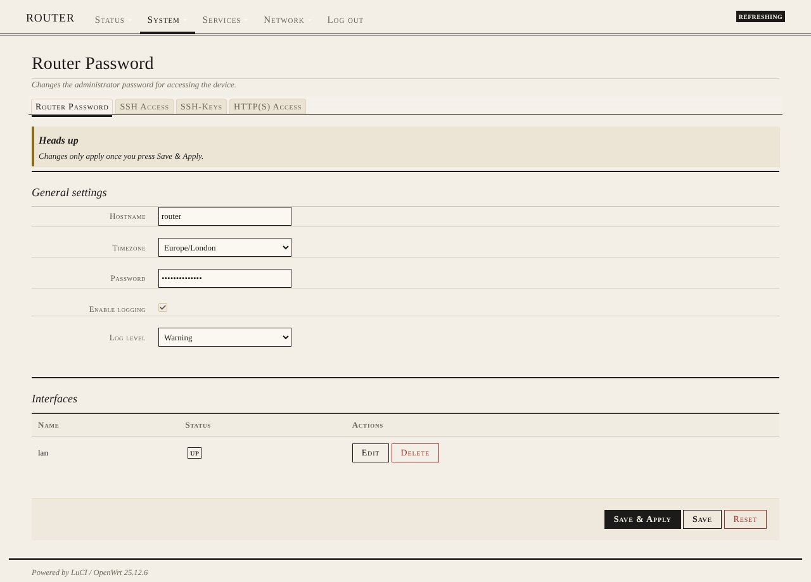

# luci-theme-paper

Paper: an e-ink / printed-page theme for LuCI, forked from luci-theme-bootstrap (Apache-2.0). Light theme.

- Warm paper, ink-black type in a book serif (Iowan Old Style / Palatino / Charter / Georgia)
- Masthead header with a double rule; navigation in small caps with an ink underline
- Sections are printed rules instead of boxes; hairline dividers, no shadows or gradients
- Buttons are plain outlines that invert on hover; Save & Apply is solid ink (red on hover)
- One sparing red accent for errors and deletes; thin ink meters
- Readable in sunlight and prints cleanly

## Install on a router
    wget -qO- https://raw.githubusercontent.com/vistrocity/openwrt-luci-themes/main/install.sh | sh -s paper

Then hard-refresh the browser. Revert: System > System > Language and Style, or
`uci set luci.main.mediaurlbase=/luci-static/bootstrap && uci commit luci`.

## Customise
"Paper overrides" at the end of `htdocs/luci-static/paper/cascade.css`: the `--pp-*` variables
(`--pp-bg` for paper tone, `--pp-accent` for the red) and `--font-sans` for the typeface.
