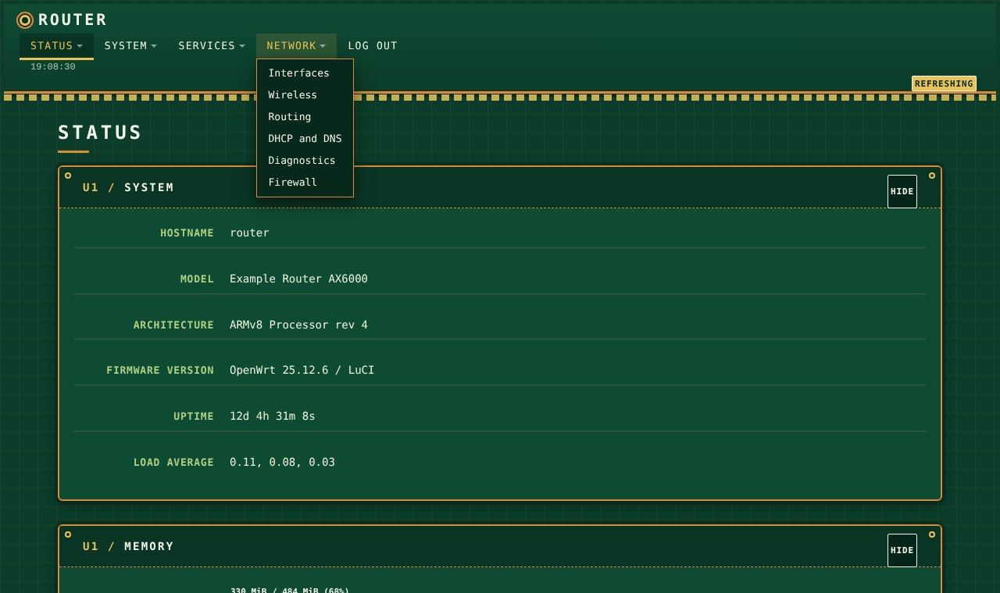
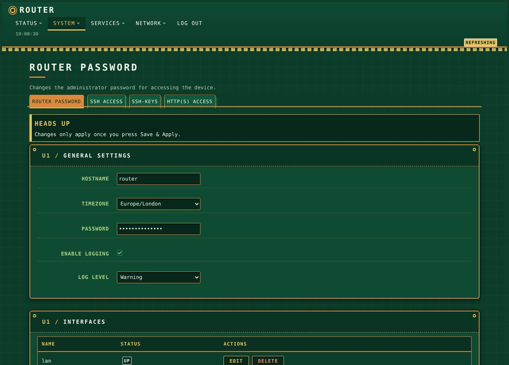

# luci-theme-pcb

PCB: a custom theme for LuCI, forked from luci-theme-bootstrap (Apache-2.0). Dark theme.

A solder-green board: copper-edged panels with corner vias, silkscreen reference labels, gold pad meters and a connector strip.

## Install on a router
    wget -qO- https://raw.githubusercontent.com/vistrocity/openwrt-luci-themes/main/install.sh | sh -s pcb

Then hard-refresh the browser (Ctrl+Shift+R). Revert: System > System > Language and Style, or
`uci set luci.main.mediaurlbase=/luci-static/bootstrap && uci commit luci`.
