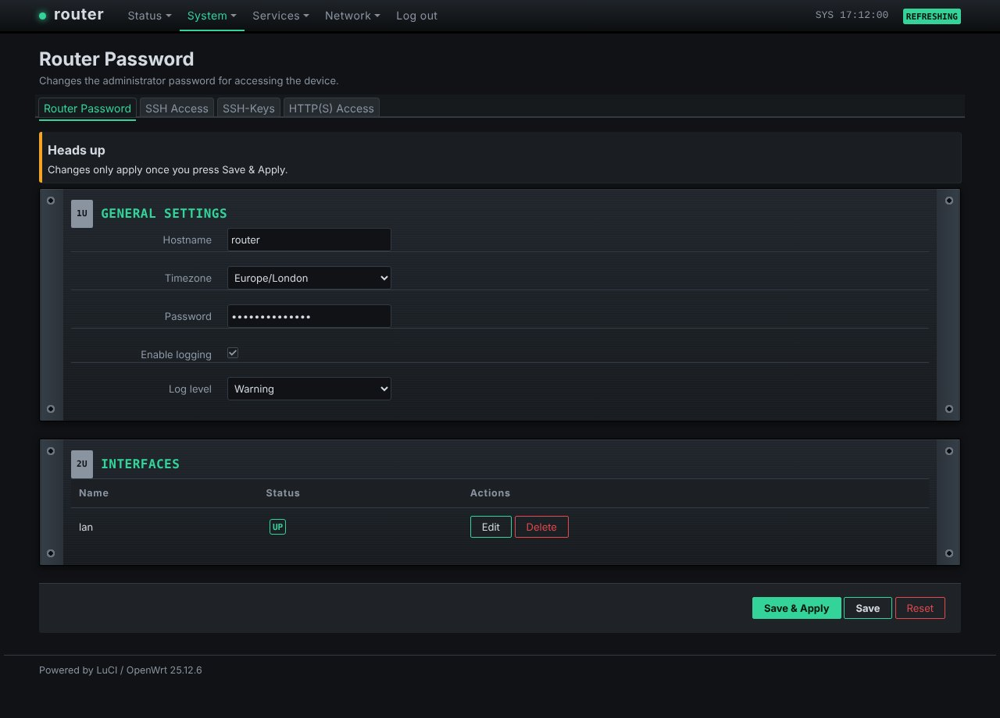

# luci-theme-rack

Rack: a custom theme for LuCI, forked from luci-theme-bootstrap (Apache-2.0). Dark theme.

- Sections are rack units: mounting ears with screws, numbered U labels, brushed metal
- Blinking green status LED next to the hostname (stops under reduced motion)
- Monospace port badges, LED-style segmented meters, green/amber accents

## Install on a router
    wget -qO- https://raw.githubusercontent.com/vistrocity/openwrt-luci-themes/main/install.sh | sh -s rack

Then hard-refresh the browser (Ctrl+Shift+R). Revert: System > System > Language and Style, or
`uci set luci.main.mediaurlbase=/luci-static/bootstrap && uci commit luci`.

## Customise
"Rack overrides" at the end of `htdocs/luci-static/rack/cascade.css`; colours are the `--t-*` variables.
