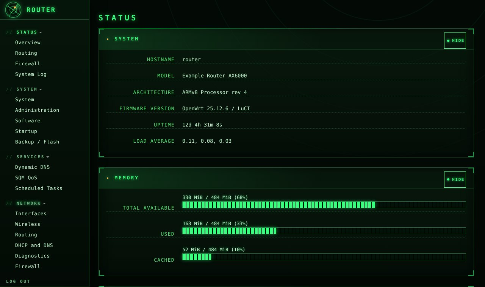
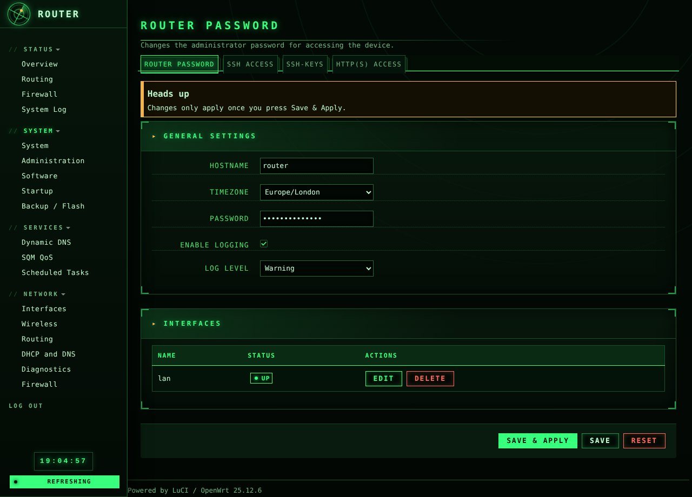

# luci-theme-radar

Radar: a custom theme for LuCI, forked from luci-theme-bootstrap (Apache-2.0). Dark theme.

A phosphor scope with a left range rail: green on black, range rings, corner brackets, blip labels and a sweep that stops for reduced motion.

## Install on a router
    wget -qO- https://raw.githubusercontent.com/vistrocity/openwrt-luci-themes/main/install.sh | sh -s radar

Then hard-refresh the browser (Ctrl+Shift+R). Revert: System > System > Language and Style, or
`uci set luci.main.mediaurlbase=/luci-static/bootstrap && uci commit luci`.
