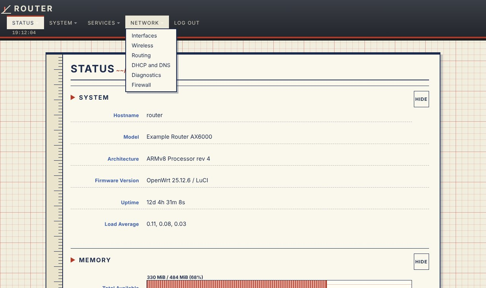
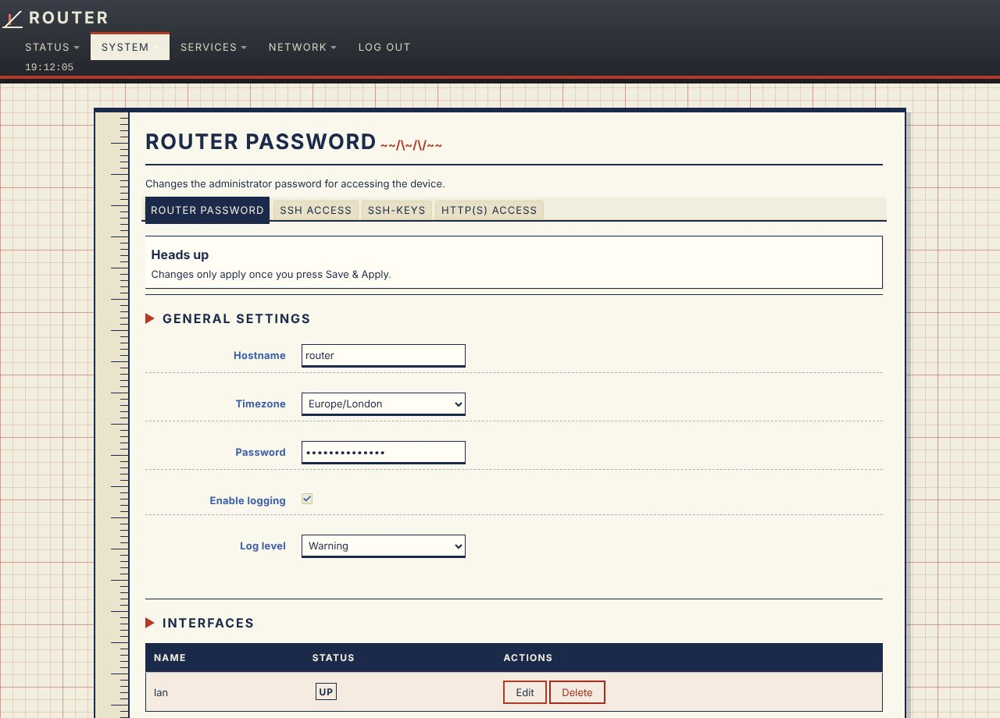

# luci-theme-seismograph

Seismograph: a custom theme for LuCI, forked from luci-theme-bootstrap (Apache-2.0). Light theme.

Paper chart recorder: ruled chart paper, a time scale down the edge, pen-arm headings and ink-trace meters

## Install on a router
    wget -qO- https://raw.githubusercontent.com/vistrocity/openwrt-luci-themes/main/install.sh | sh -s seismograph

Then hard-refresh the browser (Ctrl+Shift+R). Revert: System > System > Language and Style, or
`uci set luci.main.mediaurlbase=/luci-static/bootstrap && uci commit luci`.
