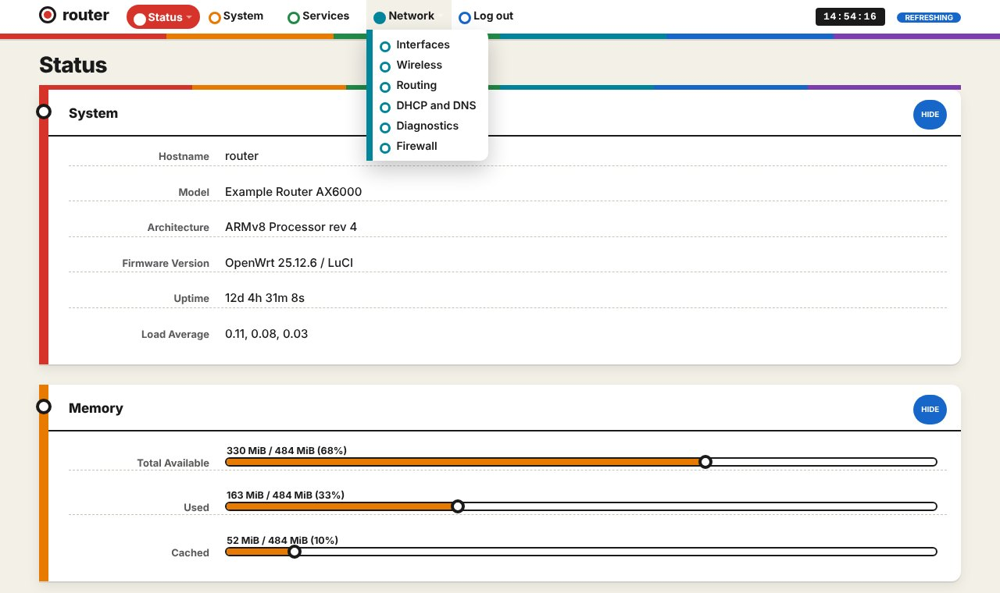
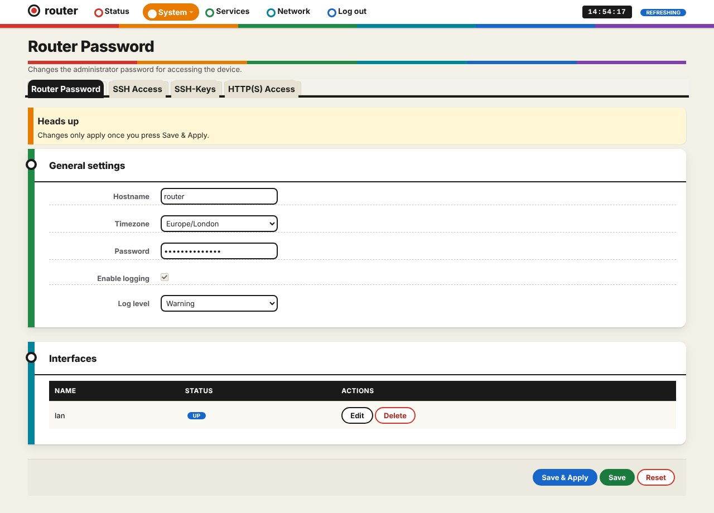

# luci-theme-subway

Subway: a custom theme for LuCI, forked from luci-theme-bootstrap (Apache-2.0). Light theme.

A transit map: the menu is a set of coloured lines with station dots, sections hang off a route line, meters end in a station.

## Install on a router
    wget -qO- https://raw.githubusercontent.com/vistrocity/openwrt-luci-themes/main/install.sh | sh -s subway

Then hard-refresh the browser (Ctrl+Shift+R). Revert: System > System > Language and Style, or
`uci set luci.main.mediaurlbase=/luci-static/bootstrap && uci commit luci`.
